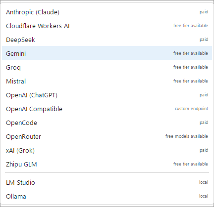
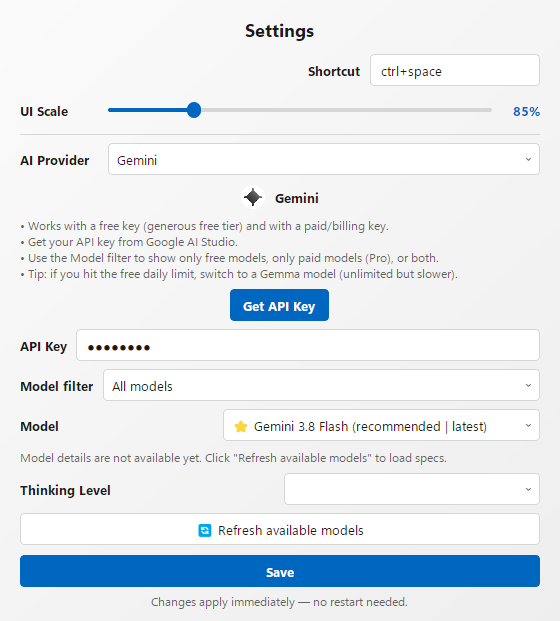

 

  <b>A system-wide AI writing assistant for Windows.</b> 
  Select text, press <kbd>Ctrl</kbd>+<kbd>Space</kbd>, and use a ready-made preset or your own instruction to proofread, rewrite, translate, summarise, and more.

  
  
  
  

Maintained by <a href="https://github.com/Ulf3000">Ulf3000</a>

## What is Writing Tools?

Writing Tools is a free, open-source desktop app that brings AI assistance to almost any Windows app: your browser, email client, editor, office suite, or chat app.

Select text and choose a preset, or write your own instruction. The result replaces your selection in place. You can also summarise longer content, ask follow-up questions, or start a chat without selecting text.

The original project was created by [Jesai Tarun](https://github.com/theJayTea). The original version is no longer actively developed; this maintained fork continues the project with provider updates, fixes, and new builds.

## Presets, your way

Writing Tools comes with useful presets so you can get started immediately:

- **Proofread** — fix grammar, spelling, and punctuation.
- **Rewrite** — improve phrasing while preserving meaning.
- **Friendly**, **Professional**, **Concise** — adjust tone or length.
- **Summary**, **Key Points**, **Table** — turn selected content into a structured result.

The main idea is customisation: **every action is an instruction you control.** Use **Custom** to enter anything you want, such as “translate to French”, “explain this simply”, “make this title case”, or “add comments to this code”. Add your own actions, then rename, change icons, reorder, or remove them. You can also assign actions their own hotkeys.

Summary, Key Points, and Table open in a separate Markdown-rendered window. Select a whole article or use a YouTube transcript, then ask follow-up questions about the content.

Press `Ctrl+Space` with no text selected to start a chat. Chat history lasts while the window is open.

## AI providers

Choose a provider in **Settings → AI Provider**. There is one entry per provider, sorted by name, with the two local ones grouped at the bottom. Switching providers keeps your presets.

| Provider | Access |
|---|---|
| Gemini | Free tier; paid/billing accounts also unlock the Pro models |
| Groq | Free tier |
| Mistral | Free tier |
| Cloudflare Workers AI | Free daily allowance |
| Zhipu GLM | Free tier (GLM Flash models) |
| OpenRouter | Free and paid models (free IDs end in `:free`) |
| OpenAI (ChatGPT) | Paid API |
| Anthropic (Claude) | Paid API |
| DeepSeek | Paid API, very low prices |
| xAI (Grok) | Paid API |
| OpenCode | Pay-as-you-go gateway to OpenAI, Anthropic, Google, DeepSeek, GLM, Kimi and more |
| OpenAI Compatible | Any OpenAI-compatible endpoint or self-hosted server — e.g. Together AI, Cerebras, NVIDIA NIM, Hugging Face, Cohere, SambaNova |
| LM Studio | Local models |
| Ollama | Local models |

### Free or paid models

Each provider has a **Model filter** (All / Free / Paid) directly above its model dropdown, so a paid account and a free account can use the same provider without guessing which models are available.

The filter is strict: if a provider has no models in the chosen tier, the list says *“No models match this filter”* rather than offering a model from the other tier. Your configured model is kept while you switch filters and is only replaced when you pick another one.

### Per-provider settings

Every provider keeps its own API key, model and filter. Editing one provider never changes another, and switching providers no longer discards what you typed — nothing is written to `config.json` until you press **Save**. Closing the window without saving leaves the file untouched.

Model availability changes. In Settings, refresh the selected provider’s model list to see what is currently available. Some providers require an API key; local Ollama and LM Studio can run without one.

## Why Writing Tools?

- **Works across apps:** use AI wherever you can select text.
- **Customisable:** start with useful presets, then create actions for your own workflow.
- **Flexible models:** use cloud providers or local models.
- **Clipboard-friendly:** the app temporarily uses the clipboard to read and replace your selection, then restores its previous contents.
- **Privacy-conscious:** text is sent only to the provider you choose when you invoke an action. Local models can keep processing on your device.
- **Free and open source:** GPLv3, with no subscription or built-in ads.

## Install

1. Download the latest `Writing.Tools.zip` from the [Releases](https://github.com/Ulf3000/WritingToolsRE/releases) page.
2. Extract it and run `Writing Tools.exe`.

Writing Tools is portable. If you extract it into a protected folder such as `Program Files`, run it as administrator on first launch so it can create its configuration files.

Writing Tools lives in the system tray. **Double-click the tray icon** to open Settings, where you pick a provider, paste the API key and can enable **Start on boot**. On the first start the Settings window opens by itself.

The UI scale can be changed in Settings (70–140 %); the app offers to restart itself so the new scale takes effect.

## Notes

- In Microsoft Word, `Ctrl+Space` clears formatting by default. Change Writing Tools’ shortcut or remap Word’s shortcut if needed.
- Replacing selected text in Word may remove rich-text formatting such as bold, italics, and colours.
- Cloud providers have their own privacy policies and terms. API keys and settings are stored locally in `config.json`; local providers process text on your device.

## Run or build from source

- [Run Writing Tools from source](https://github.com/Ulf3000/WritingToolsRE/blob/main/README's%20Linked%20Content/To%20Run%20Writing%20Tools%20Directly%20from%20the%20Source%20Code.md)
- [Compile the application](https://github.com/Ulf3000/WritingToolsRE/blob/main/README's%20Linked%20Content/To%20Compile%20the%20Application%20Yourself.md)
